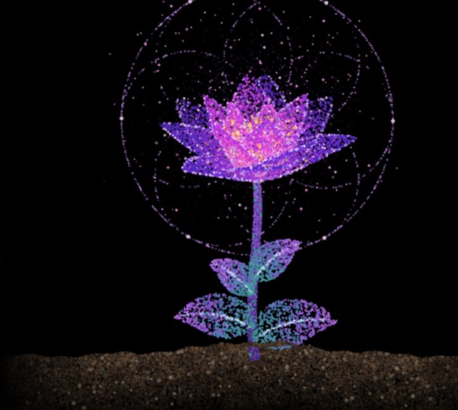

    A generative pointillist art experiment in Python that simulates the complete lifecycle of a blooming flower—sprouting from textured soil, opening in multi-layered petal arrangements, emitting glowing aura particles, and gradually wilting over time.

## Features 

- Procedural Pointillism: Creates the soil, stem, leaves, and petals using thousands of animated dot particles called “splats” instead of ordinary solid colors.

- Keyframe-Based Lifecycle: Animates the flower's growth by smoothly transitioning through different stages, including soil movement, stem growth, leaf opening, full blooming, and gradual withering.

- Bézier Curves and 3D Rendering: Shapes the stem using mathematical Bézier curves and creates layered 3D petals with depth effects and natural swaying movements.

- Atmospheric Effects and Glow: Adds visual enhancements such as rotating energy rings, glowing stamens, soft light effects, and floating petal particles that fall as the flower wilts.

- Interactive Interface and Batch Export: Provides an interactive Tkinter window with keyboard shortcuts (Space, R, S, and Esc), along with headless options for exporting PNG images of different growth stages or an animated GIF.

hOw Tow Run:

use your legs.

