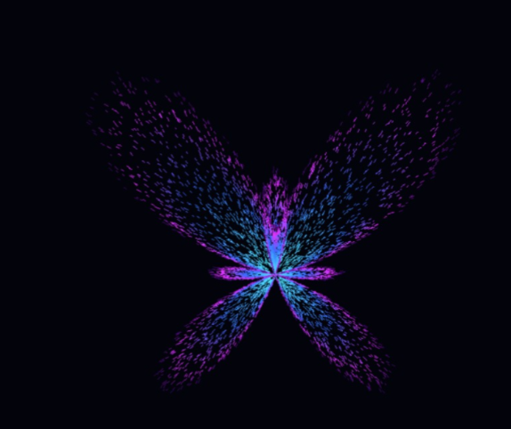

# Butterfly 

## An art experiment in Python using parametric mathematics (Fay's Butterfly Curve) and Tkinter canvas rendering to create a neon-glowing butterfly.

## Features 

- Parametric Curve: Implements Temple H. Fay's butterfly equation with randomized micro-segments.

- Neon Gradient: Multi-stop color blending (Cyan → Electric Blue → Magenta → Deep Purple).

- Zero External Dependencies: Built entirely with Python's standard library (turtle, tkinter, math, random).

